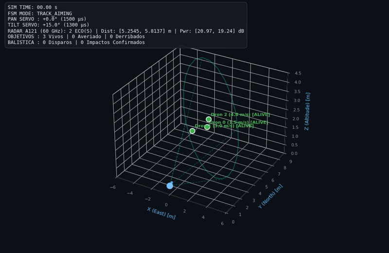
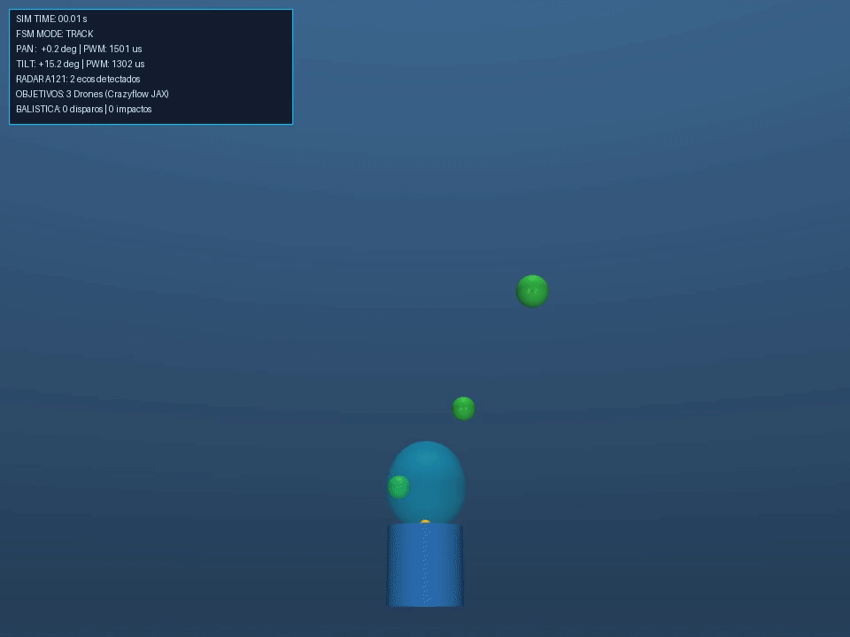

# Objetive Adquisition

**Estado del proyecto: en desarrollo.**

Simulador Python de una plataforma pan/tilt de dos grados de libertad con
un modelo de radar Acconeer A121, objetivos aéreos, dinámica de proyectiles
y visualización 3D. Incluye un motor cinemático y una integración opcional
con Crazyflow/JAX para la dinámica de los drones.

El simulador permite probar políticas de adquisición de objetivos en un entorno
virtual antes de evaluar su aplicación en la torreta física. También está pensado
como entorno de entrenamiento para modelos de IA que complementen o sustituyan
esas políticas.

El radar y los actuadores son modelos de software. El SDK C y los archivos
de hardware se conservan como referencias independientes del simulador.

## Física

La sección física reúne los ensayos de banco, los sketches de Arduino y su
documentación. El primer ensayo usa un sensor de ultrasonidos y un servo para
observar el comportamiento de un filtro de Kalman. Los resultados y las
grabaciones de los próximos ensayos tendrán su sitio en esta sección.
[README de las pruebas físicas](fisica/README.md)

## Vista previa

### Simulación Matplotlib




### Simulación MuJoCo



## Estructura

```text
.
├── run_simulation.py         # Entrada de línea de comandos
├── core/                     # Coordenadas y geometría
├── actuators/                # Modelo de servomotores
├── sensors/                  # Modelo de radar A121
├── targets/                  # Drones, trayectorias e integración Crazyflow
├── turret/                   # Plataforma y controlador
├── ballistics/               # Proyectiles y colisiones
├── sim/                      # Entorno y escenarios
├── visualization/            # Matplotlib y MuJoCo
├── tests/                    # Pruebas unittest
├── docs/simulation_plan.md   # Plan de diseño original
├── fisica/                   # Sketches de Arduino, documentación y vídeos de banco
├── hardware/                 # Esquema, bibliotecas Altium y proyecto inicial IDE
├── vendor/acconeer_sdk/      # SDK original, documentación y licencias
├── assets/examples/          # GIF y vídeos de ejemplo existentes
├── outputs/                  # Resultados locales, excluidos de Git
├── requirements.txt          # Dependencias básicas
└── requirements-physics.txt  # Dependencias físicas y gráficas opcionales
```

Los paquetes Python conservan su ubicación e importaciones originales.
Ejecuta los comandos desde la raíz del repositorio.

## Instalación

El entorno de referencia utiliza **Python 3.10**. Para el simulador básico:

```bash
python3.10 -m venv .venv
source .venv/bin/activate
python -m pip install -r requirements.txt
```

Para incluir Crazyflow/JAX y el visualizador MuJoCo:

```bash
python -m pip install -r requirements-physics.txt
```

Los archivos de requisitos fijan las versiones del entorno de referencia;
no constituyen un bloqueo completo de dependencias transitivas.
Si Crazyflow no está disponible, el entorno utiliza el modelo cinemático.
Cuando está instalado, se activa automáticamente por defecto.

## Uso

Consulta las opciones disponibles:

```bash
python run_simulation.py --help
```

El punto de entrada incluye ejecución sin ventana, selección de escenarios,
visualización interactiva y exportación de animaciones. Guarda las nuevas
salidas dentro de `outputs/` para mantener limpio el repositorio.

La exportación MP4 requiere **FFmpeg** en el `PATH`. La visualización
interactiva MuJoCo requiere un entorno gráfico compatible con OpenGL;
el renderizado sin pantalla también necesita un backend OpenGL apropiado.
Para ejecutar pruebas en equipos sin escritorio puedes usar `MPLBACKEND=Agg`.

## Pruebas

La suite existente utiliza `unittest`:

```bash
MPLBACKEND=Agg python -m unittest discover -s tests -v
```

Las pruebas de Crazyflow requieren las dependencias opcionales: actualmente
comprueban su disponibilidad en vez de omitirse cuando faltan. Las pruebas
MuJoCo sí incluyen una omisión cuando ese componente no está disponible.

Para comprobar únicamente la geometría y los servomotores con la instalación básica:

```bash
python -m unittest tests.test_coordinates tests.test_servo_motor -v
```

## Documentación y ejemplos

- [Plan de diseño original](docs/simulation_plan.md): describe la arquitectura
  prevista y puede incluir propuestas pendientes; no sustituye al código actual.
- [Recursos de hardware](hardware/README.md).
- [SDK y licencias del fabricante](vendor/README.md).
- [Animación de ejemplo](assets/examples/test_anim.gif).
- [Vídeo Matplotlib](assets/examples/test_video.mp4).
- [Vídeo MuJoCo](assets/examples/test_mujoco.mp4).

## Licencias

Copyright (c) 2026 Carlos Barcenilla Villalon. Todos los derechos reservados.

El material original del proyecto se distribuye bajo una
[licencia propietaria de evaluación](LICENSE.md): permite consultar y ejecutar
el proyecto para evaluar al autor en entrevistas y procesos de selección.
Cualquier uso empresarial interno, comercial, productivo o reutilización en
otros proyectos requiere autorización previa y escrita y un acuerdo independiente
con el titular que establezca el alcance, el precio y las condiciones.

Los componentes y recursos de terceros mantienen sus propias licencias.
En particular, el SDK conserva sus avisos y licencias originales en
[`vendor/acconeer_sdk/LICENSES/`](vendor/acconeer_sdk/LICENSES/).
Consulta [LICENSE.md](LICENSE.md) para conocer las condiciones completas.
